<p align="center">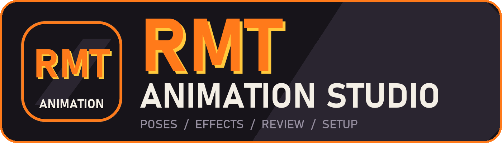</p>

# RMT Animation Studio

One app for the poses, effects, review and setup of City Breaker / BSP Universe clips (Electron + three.js). It grew out of
Fight Studio Desktop and the Godot Effect Studio, which are left as they were. Modes (top bar, Alt+1..5): **POSE** (everything
described below), **FX** (edit any effect block live), **COMPOSE** (effect recipes on the move), **REVIEW** (a verdict, frame data,
striker speed and reach), **SETUP** (nine steps from model to saved clip, each with a fix). Library panel: Models / Animations /
Effects. The full design and what was measured is in `docs/SUITE_SPEC.md`. Everything under "What it does" below is POSE mode.

The rest of this file is the Fight Studio Desktop text it started from: it opens and saves the same clip files the game plays
(`<project>/game/packs/city_breaker/data/clips/<name>.json`), with the same interpolation, rules and file format as the Godot
**Fight Studio Animator** (`game/packs/city_breaker/animator`), so you can switch between the two on the same clip. Fighters load
straight from the game's GLBs (`assets/chars/<key>_fight.glb`); poses, rig controls and sockets are shared files.

## Screenshots

**POSE** - the Fight Studio workspace: four views, dope sheet, rig controls, and the Library (models, animations, effects).
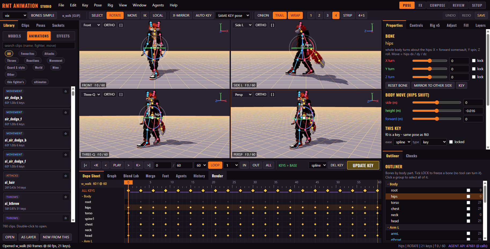

**Library + FX lane** - 201 effect blocks to browse, and effect cues on their own lane in the dope sheet.
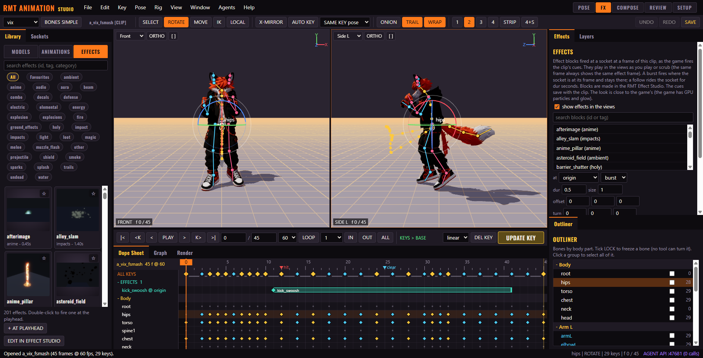

**FX** - FX Studio edits any effect block live: layer timeline, shader knobs read from the .gdshader, save or revert.
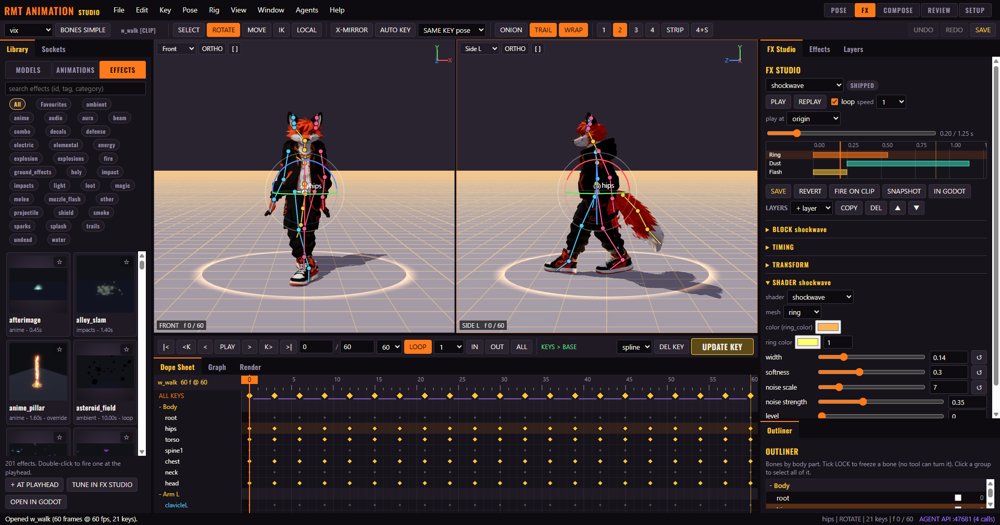

**COMPOSE** - recipes put the right effects on the right frames of the move, with snaps and its own undo.
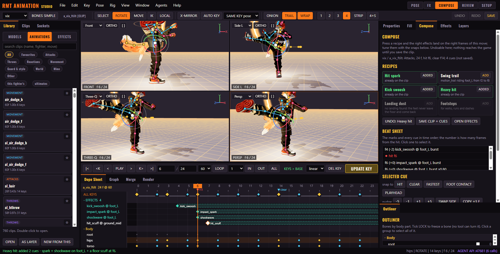

**REVIEW** - a verdict on the open move from real checks; here it flags an impact spark that lands 4 frames after the hit.
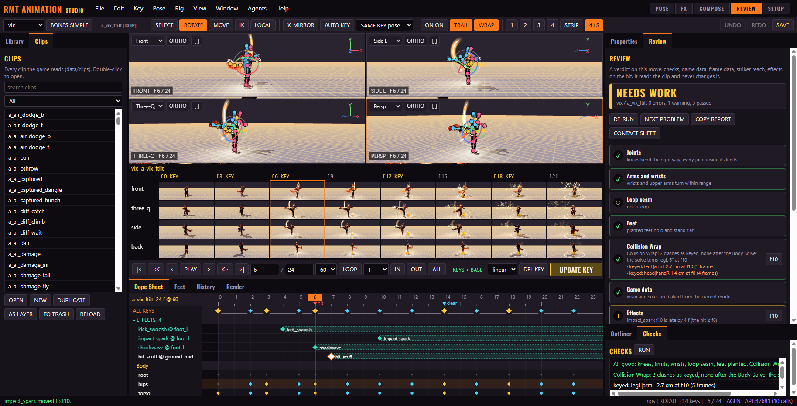
The same move as saved, with no effect cues, reads READY: an attack with no effect is a note, not a warning (from the packaged app).
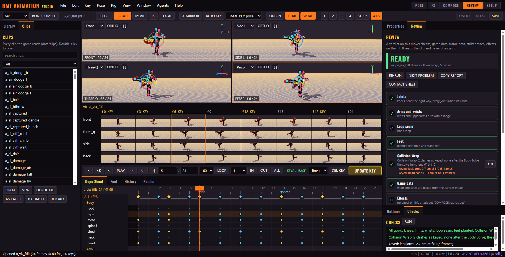

**SETUP** - nine steps from model to saved clip, each with a fix (or FIX ALL).
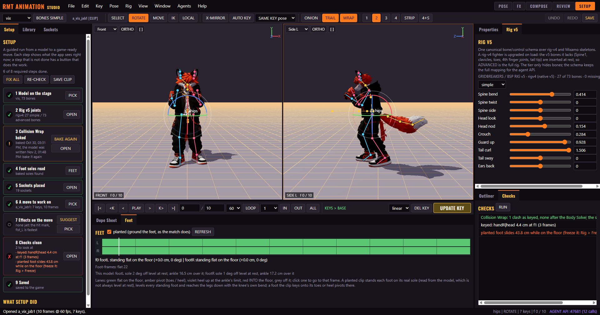

## What it makes: City Breaker ultimates, live

These clips are not recordings of the app. They are the game playing ultimates (final smashes) whose animations were keyed in
Fight Studio and whose effects were built in the Effect Studio, the two tools this suite brings together: poses, FX cues,
camera cuts and comic layers all running in City Breaker's test lab (13 s, 720p, with sound). Click a picture to play.

[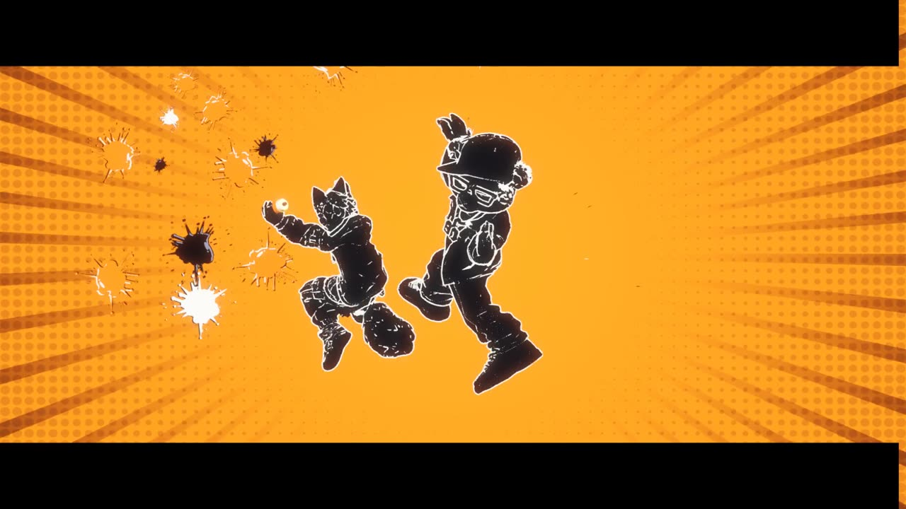](docs/videos/vix_ultimate.mp4)
**Vix - ALL CITY**: a paint-spray catch, the victim splatted on the wall, then a kick through it.

[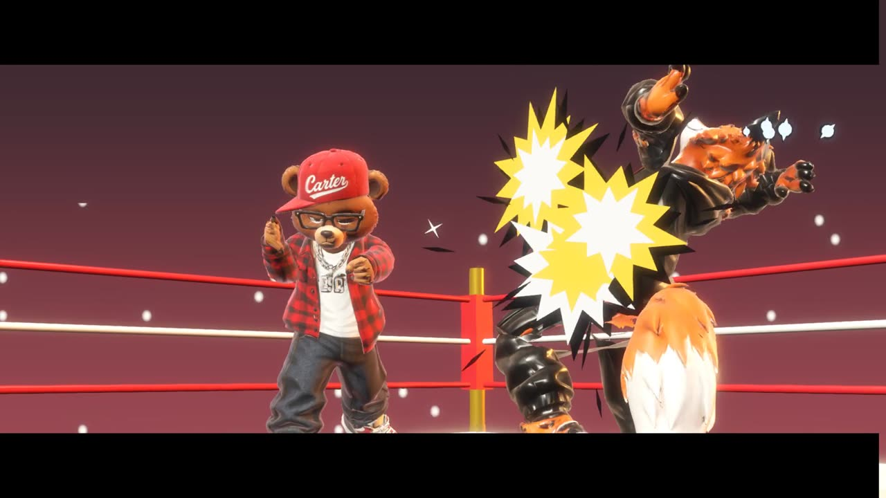](docs/videos/carter_ultimate.mp4)
**Carter - MAIN EVENT**: boxing ring, POW flurry, an uppercut through the lights, and the belt.

[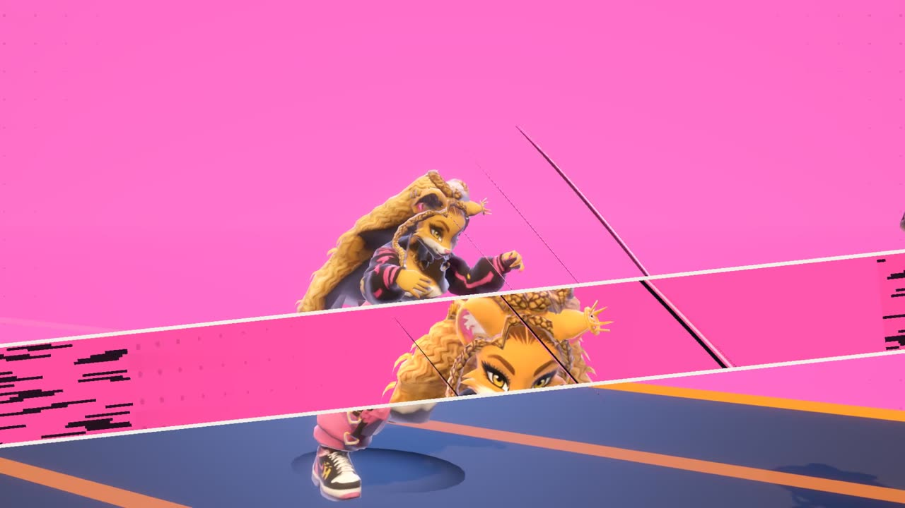](docs/videos/kat_ultimate.mp4)
**Kristine - NINE LIVES**: the yarn ball, nine ghost clones and the claw swipes under the moon.

## Install

Run `RMTAnimationStudio-Setup-<version>.exe` (Windows 10 / 11, 64-bit; the current one is 2.0.0). On first start it asks for the
**game project folder**: the Godot project with `game/packs/city_breaker` in it. File > Choose the game project folder changes it
later. Setup's bakes and the FX Studio's "open in Godot" need Godot on the machine too (`FIGHT_STUDIO_GODOT` names the exe).

The installer is not code-signed, so Windows SmartScreen may say "Windows protected your PC": click More info > Run anyway.

## Run from source

```
cd D:\Projects\RMTAnimationStudio
npm install
npm start                          # or: node_modules\electron\dist\electron.exe .
npm start -- --fighter=carter --clip=a_jab1 --mode=REVIEW
npm run selftest                   # 338 checks, about 4 min, prints to out/desktop.log (--only-wrap: the wrap block only)
npm run dist                       # builds dist/RMTAnimationStudio-Setup-<version>.exe (and dist/win-unpacked)
```

Building the installer: `tools/make_icon.py` draws `build/icon.png` / `build/icon.ico`, then `tools/make_installer_art.py` draws the
wizard's pictures (`installerSidebar.bmp`, `uninstallerSidebar.bmp`, `installerHeader.bmp`) and the logo (`build/logo.png`,
`docs/logo.png`); both need Pillow, and the sidebar uses a frame from `docs/videos`. On Windows without the
symlink privilege electron-builder cannot extract its winCodeSign archive; unpack it by hand into
`%LOCALAPPDATA%\electron-builder\Cache\winCodeSign\winCodeSign-2.6.0` (the two macOS dylib link errors can be ignored).

Options: `--fighter=` `--clip=` `--mode=POSE|FX|COMPOSE|REVIEW|SETUP` `--project=<Godot project>` `--api-port=47680` `--no-api` `--windowed`
`--unfocusable` (a window that never takes your keyboard) `--shot=path.png` (screenshot and quit) `--verbose`.
`FIGHT_STUDIO_PROJECT` sets the project too, and `FIGHT_STUDIO_GODOT` the Godot exe for File > Open in the Godot Animator.

## What it does (the same as the Godot Animator)

- **Canvas**: 1, 2, 3, quad, the **strip** (front / three-quarter / side / back x moments of the clip, live, the review-sheet
  look) or quad + strip. Each view: Persp, Front, Three-Q, Side L / R, Back, Top, Follow; ORTHO; `[ ]` maximize. One WebGL
  renderer draws every view through scissor regions; View > Render scale supersamples for HD / 4K.
- **Posing**: ROTATE (swing a joint, or drag a coloured ring to turn about one axis, LOCAL / GLOBAL), MOVE (slide the body),
  IK (pull a hand / foot and the limb bends; pull any other joint and its parents bend), X-MIRROR. Every joint stays in its
  natural range (`data/animator_rig.json`): knees and elbows are hinges, and the IK bends them only on their hinge.
- **Keys**: K / AUTO KEY, eases (linear, in, out, inout, hold, spline), key types, lock keys, link keys, and **SAME KEY**
  (off / linked / same pose / same value): an updated key updates the same key elsewhere. Insert / delete frames, scale
  time, reverse, close loop, breakdowns.
- **Locks and freezing**: lock bones or single channels; FREEZE pins a bone in the world over a frame range.
- **Adjust**: tilt a part across the whole clip, a frame range or around one frame, without touching its keys (drag TILT,
  Shift for fine). Adjusted parts get a `*` in the Outliner; RESTORE takes an adjustment off; it never turns a joint past
  its limits.
- **Merge**: one animation from several. The open clip is the base; each clip on top gives only the parts you light up
  (Head, Spine, Arm L / R, Hands, Hips, Legs, Tail) from a start frame, blending in and out. BAKE makes one new clip and
  keeps the recipe, so REBUILD THE SETUP brings it back.
- **Fill**: the frames between two keys, made for you. SHAPE makes the move by the rules of good motion (timing smooth /
  even / strike / settle, Flow through the keys, Overlap, Anticipate, Overshoot); LIBRARY finds how your own clips make the
  same change (mirrored too) and bends it onto your two keys. Joints stay in their limits, planted feet stay put or step,
  keyed spins stay spins. The made frames are plain breakdown keys; once filled the knobs change it live; REMOVE gives the
  keys back. The same as the Godot Animator's Fill (its `FILL_PLAN.md` has the research and design).
- **Learned from real motion** (`data/motion_dna.json`, measured on the Motion Library's motion capture by
  `MotionLibrary/study/study.py`, `study_more.py`, `study_more2.py`, `study_more3.py`): Fill's timing menu has eight learned
  timings (natural, punch with the hips leading, kick, swing kick, hit reaction that snaps and trails, arrive that goes past
  and settles, land that sinks into the knees and comes back up, turn where the head leads the hips round); the Layers panel's **ALIVE** puts breathing, head nods against the breath, arm sway and slow drift learned
  from real idles on the clip as one layer (calm / fight / tired / lying / winded, quieter while the clip moves, loops seamlessly, bakes
  like any layer); **GAIT** lays a real walk / run's torso and chest turn, head counter-turn and arm swing on a walk or run
  clip in time with its own steps (only what it lacks; the hips and bob are left to the feet grounding); **BALANCE** leans the
  chest and torso away from every kick in the clip like real swing kicks (only what it lacks); and Fill's LIBRARY
  also searches the library's real
  clips (`real/<clip>`; folder: the app setting, `FIGHT_STUDIO_MOTION_LIBRARY`, else `D:/Projects/MotionLibrary/clips`).
  The same as the Godot Animator (`core/alive.gd`, `core/gait.gd`, `core/balance.gd`, `core/fill.gd`); the self-test checks
  the keys match.
- **Effects**: the game's RMT effect blocks (`addons/rmt_effects`) fired at a socket at a frame of the clip, the way the game
  fires a clip's cues (`data/clip_fx.json`, `CBFxRmt.cue`): pick a block, a socket and burst (fires where the socket is at its
  frame and stays for its block's duration) or follow (rides the socket for dur seconds; a block with a trail layer, such as
  `motion_trail`, draws a glowing tube along the socket's path; its sparks are born along the path too, also when you jump
  to a frame), + AT THIS FRAME. They play in the views and the strip as you
  play or scrub, frozen in between (the same frame always shows the same effect frame), and save with the clip. Offsets and
  turns are in the game's frame at match size, so they mean what they mean in a match. The engine is the Godot Animator's and
  the Effect Studio's (`src/core/placements.js` = `rmt_effects/core/placements.gd`): the same socket points (within half a
  centimetre) and burst spots. The blocks are built here in three.js (`src/core/rmtfx.js`): particles simulated on the CPU
  from each block's settings, every particle from its own seed, and the meshes drawn with the game's own shaders, translated
  from Godot when they load (`src/core/gdshader.js`). The look is close to the game's, not the same pixels (the game has GPU
  particles and glow). OPEN IN EFFECT STUDIO starts the RMT Effect Studio (Godot) on this fighter, clip and frame to make or
  change a block.
- **Feet**: a planted clip stands each foot on its real sole (read off the model's mesh, the same as the game's
  `CBFeet.ground`): feet levelled, legs reached down with the knee's own bend, toes / heel pivots kept, nothing into the
  floor. The Feet panel shows per-foot lanes (flat / pivot / loose / limit / sink / air) across the clip. **Planted feet**
  (Checks, 2026-10-30, after Repo Bruiser's boots: "feet leaning sideways ... they suppose to be planted to the ground"): a
  foot just off the floor that the match will not stand flat - not the lower foot and tipped over 12°, or keyed onto its toes
  but leaning over 15° sideways (`roll`) - is "loose" and warned. It used to be filed under pivot and pass. The fix: both
  soles on the floor and level (the ankle turned level, the foot reached down by `ik_pose` keep_end), or lift it clear.
- **Collision Wrap** (WRAP on the toolbar, View > Collision Wrap; on by default): the views show the pose after the match's
  Body Solve (the game's RMT Wrap, `addons/rmt_wraps`, ported in `src/core/wrap.js`): every part that went into the body or
  under the floor is bent back out by its own joints, with the same rules and numbers as the game (`data/wraps/<key>.collide.json`,
  `wrap_rules.json`, the rig's limits and hinges, max_turn, keep / max_step), on the model at its match height, the clip played
  from its first frame as a match plays it. The keys are not changed: IK and the agent API reach with the keyed pose. View >
  Wrap capsules draws the wrap (red = still in the body after the solve). Checks lists the clip's clashes as keyed and after the
  solve (pair, cm, frame, how many frames, like the game's clash test) and how far the solve turns a joint; a clip whose
  solve turns a joint more than 45° is flagged.
- **Wrists and arm roll** (Checks, 2026-10-30, after Al's and Guru's ultimates): IK that keeps the hand's world turn
  (`ik_pose` keep_end, the default) leaves the wrists twisted and the upper arms rolled, and fills swing between them - the
  "loose and crazy arms". Checks warns when a wrist turns more than 20° in one 60 fps frame or swings more than 70° on an
  axis over the clip, or an upper arm rolls more than 20° in a frame or 100° over the clip; 12-20° in a frame is a note
  (landings and snaps do that on purpose). The fix: place hands with `ik_pose` keep_end false, the wrist a small bend.
- **Motion import**: File > Import motion takes a Mixamo FBX (or a GLB / glTF with a Mixamo-style skeleton) onto our rig as
  a new clip: lined up from T-pose to our A-pose, in place, inside the joint limits, loop / planted detected.
- **Panels**: Clips, Poses (mirror, flip, copy / paste, pose library), Sockets (+ props, and grey grip proxies that sit in the
  hand by the game's grip frame), Properties, Controls (one slider, many bones; add your own), Adjust, Fill, Effects, Layers (keys / clip
  layers, add / add_delta / override, masks, fades), Constraints (IK, freeze, aim, limit, copy, floor / plant), Outliner,
  Checks, Dope Sheet, Graph, Blend Lab (transitions, mixes), Merge, Feet, Agents, History, Render (HD / Full HD / QHD / 4K
  stills, the review sheet, PNG sequences).
- **Windows**: drag a tab onto another dock; right-click a tab to float the panel in its own window (close it to dock it
  back); Window > New canvas window for a second monitor. Splitters between docks; the arrangement is remembered.
- **Saving**: Ctrl+S. The first save of a clip in a session backs the old file up (`fight_studio_backups`); clips "deleted"
  go to `fight_studio_trash`, and renders to `fight_studio_renders`, all under `D:/Cache` when it exists, otherwise
  `Documents/Fight Studio`. Live layers / constraints are baked into the game keys with the editable keys kept under
  `studio.base` (the same bake signature as the Godot app).
- **A saved clip is yours**: every save stamps `studio.saved`, and the game's clip generators (`gen_clips.py`, `gen_cast.py`,
  `gen_unique.py`) skip a clip that carries it. Delete the clip here (trash folder) to hand it back to them.

## Agents

The app serves the agent API on `http://127.0.0.1:47680/rpc` (localhost only; `GET /methods`), the same methods as the Godot
Animator on :47650, including merge, adjust, feet, fill, import_motion, the prop / grip calls, the effects on the clip
(`fx_blocks`, `fx_cues`, `fx_add`, `fx_edit`, `fx_remove`, `fx_save`, `fx_measure`, `fx_studio_godot`), and `wrap_report` / `wrap_state`
(the Collision Wrap: the clip's clash report, the solve at a frame; `set_view {wrap, wrap_caps}` switches the view). The suite adds
`set_mode`, `fx_studio` (the in-app FX mode), `setup`, `review` and `compose` (see docs/SUITE_SPEC.md). The MCP server ships with the game
project (`game/packs/city_breaker/animator/mcp/fight_studio_mcp.py`), finds whichever app is running (or set
`FIGHT_STUDIO_URL`), and `studio_launch(app="electron")` starts this one. Register it once:

```
claude mcp add -s user fight-studio -- python <project>/game/packs/city_breaker/animator/mcp/fight_studio_mcp.py
```

The Agents panel shows the MCP config with the server's path in the project you picked.

## Rig v5 (pilot)

`game/packs/city_breaker/data/rig_v5.json` is a canonical bone/control schema layered over both deform skeletons:

- **Simple** (27 bones on Vix, 17 on Hypebeast): body, arms, hands, legs, tail and ears where present.
- **Advanced** (55 on Vix, 66 on Hypebeast): adds clavicles, Spine1, toes and the complete four-joint finger chains.
- Missing bones are listed, never invented: Vix has tail/ears but no shoulder/toe/4th-finger joints; Mixamo has those but no tail/ears.
- Controls carry canonical drives (`Spine bend`, `Fist L (full)`, etc.); the app maps each drive to the model's local bone axes before posing.

The toolbar **BONES SIMPLE / BONES ADVANCED** button switches the tier, the Outliner shows canonical names (`hips`, `armL`, `handL`), and the **Rig v5** panel lists the applicable controls with a tier selector. Toggle via API: `rig_v5 {tier}`, `set_tier {tier}`, `v5_control {name, value}`. The MCP `studio_rig` now returns the v5 schema too, and `studio_set_tier` / `studio_v5_info` / `studio_v5_control` are available.

Pilot proof: `node tests/rig_v5_check.mjs` — 13 checks over Vix (rig v4) and the original Mixamo Hypebeast (17/66 bones, missing tail/ears, mapped spine and fingers). The four standard clips `idle`, `hit`, `knockdown`, `victory` are authored through Fight Studio and baked into the rig-v4 expansion models.

## Files

`main.js` (window, file access limited to the game's clip / pose / data folders, the project folder setting, pop-out windows,
the HTTP API), `preload.js`, `src/core/` (clip = the game's interpolation, doc, rig, evalc = layers + constraints + IK, body,
history, adjust, merge, feet, fill, grip, motion_import, wrap, rmtfx + gdshader + placements = the effect blocks), `src/fx.js`
(effects on the clip), `src/app.js` (every edit), `src/stage.js` (3D world), `src/views.js`
(canvas), `src/timeline.js` (dope sheet, graph), `src/panels.js`, `src/shell.js` (menus, bars, docks, windows), `src/api.js`,
`tests/selftest.js`, `build/` (the installer icon).

The heading font is Oswald (`src/fonts/oswald600.woff2`, SIL Open Font License).
